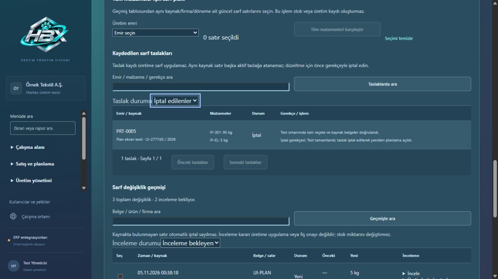
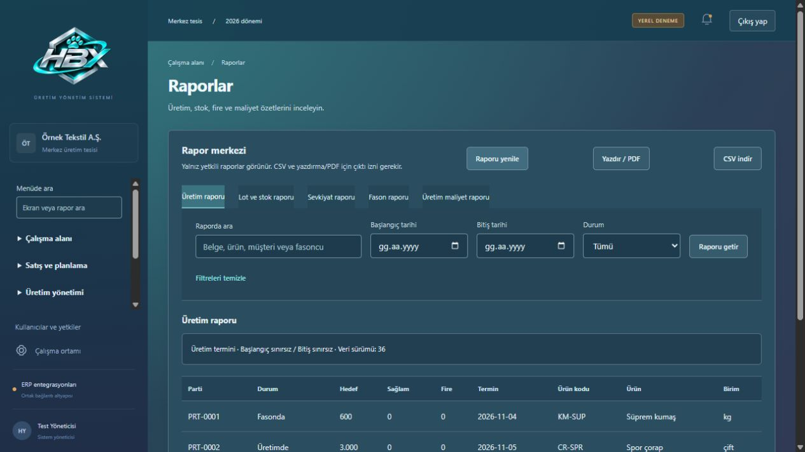

# HBX | Üretim yönetimi

HBX’i üretim emrinden mamul bildirimi ve sevkiyata kadar olan süreci tek yerde takip etmek için geliştiriyorum. Özellikle reçetedeki malzeme ihtiyacının fiilî sarfla karşılaştırılmasına ve maliyet değişikliklerinin izlenebilir olmasına odaklanıyorum.

## Kullanım akışı

1. **Üretim emri:** Reçeteye göre malzeme ihtiyacını hesapla. Gerçekleşen sarfı, sıradaki operasyonu ve parti hareketlerini emir üzerinden takip et.
2. **ERP sarfı:** Gelen sarf satırlarını emre bağlamadan önce ürün, depo ve miktar eşleşmesini kontrol et. Onaylanan satırları üretime işle.
3. **Üretim bildirimi ve rapor:** Mamul ve fire miktarlarını kaydet. Üretim kayıtlarını tarih, belge veya duruma göre süz ve CSV ya da baskı çıktısı al.

## Ekran görüntüleri

Görüntüler örnek verilerle hazırlanmıştır.

### Üretim emri

Planlanan miktar, gerçekleşen sarf ve sıradaki operasyon parti detayında birlikte görünür.

### ERP sarf arşivi

Sarf taslakları üretim emrine göre izlenir. İptal edilen taslaklar gerekçeleriyle arşivde kalır.

### Rapor merkezi

Üretim raporu ürün kodu ve ölçü birimiyle birlikte filtrelenebilir. CSV ve yazdırma seçenekleri aynı filtreyi kullanır.

## Geliştirme notları

### ERP sarfı ve maliyet takibi

ERP’den gelen sarfı üretim emrine bağladım. Aynı belge satırı tekrar geldiğinde sistem mevcut kaydı koruyor. ERP’de işlenmiş sarf HBX stoklarına ikinci kez yansımıyor.

Maliyet değişikliklerinde eski ve yeni tutarları aynı ekranda gösteriyorum. Mamul veya fire bildirimi yapılmadan önce incelemesi tamamlanan maliyet farkı, yetkili kullanıcı tarafından gerekçesiyle emre işlenebiliyor. Miktar da değişmişse ekran ayrı inceleme gerektiğini belirtiyor.

Bu akışı örnek verilerle test ettim. Sırada miktar farklarının işlenmesi ve mamul bildirimi sonrası değerleme var.
