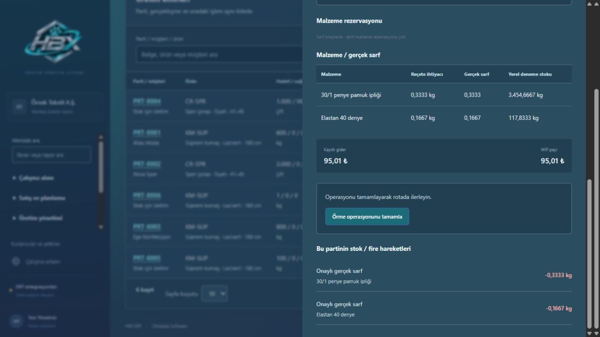

# HBX geliştirme günlüğü

HBX’i üretim emirlerini, stok kullanımını ve maliyetleri tek yerden takip etmek için geliştiriyorum. İlerledikçe burada neleri değiştirdiğimi ve nasıl test ettiğimi paylaşacağım.

## ERP sarfı ve maliyet takibi

ERP’den gelen sarfı üretim emrine bağladım. Aynı belge satırı tekrar gelirse ikinci kayıt oluşmuyor. Sarf zaten ERP’de işlendiği için HBX stoktan bir daha düşmüyor.

ERP’de maliyet sonradan değiştiğinde önceki ve yeni değerleri yan yana görebiliyorum. Mamul veya fire bildirimi yapılmadan önce incelenen maliyet farkını gerekçesiyle emre işleyebiliyorum. Miktar da değişmişse ekran maliyet düzeltmesinin neden kullanılamadığını gösteriyor.

Bu akışı örnek verilerle test ettim. Sırada miktar farklarını ve mamul bildirimi sonrası değerlemeyi ele almak var.

## HBX nasıl çalışıyor?

HBX’te üretim emrini reçeteye bağlı olarak takip ediyorum. Emirden malzeme ihtiyacına ve gerçekleşen sarfa bakıyorum. Ardından operasyonları ilerletip mamul ve fire bildirimi yapabiliyorum. ERP’den alınan sarfların taslaklarını arşivde inceliyorum ve rapor merkezinden üretim kayıtlarını süzüp çıktı alıyorum.

Aşağıdaki ekranları örnek verilerle hazırladım.

### Üretim emri

Bu ekranda reçete ihtiyacını gerçekleşen sarfla karşılaştırıyorum. Sıradaki operasyon ve partiye ait hareketler de aynı yerde.

### ERP sarf arşivi

Üretim emrine bağlı sarf taslaklarını ve durumlarını burada takip ediyorum. Örnekte iptal edilmiş taslağın gerekçesi kayıtlı duruyor.

### Rapor merkezi

Üretim raporunda belgeye, tarihe veya duruma göre filtre uyguluyorum. Ürün ve birim bilgisiyle birlikte sonucu görüyor, gerektiğinde CSV veya baskı çıktısı alıyorum.

